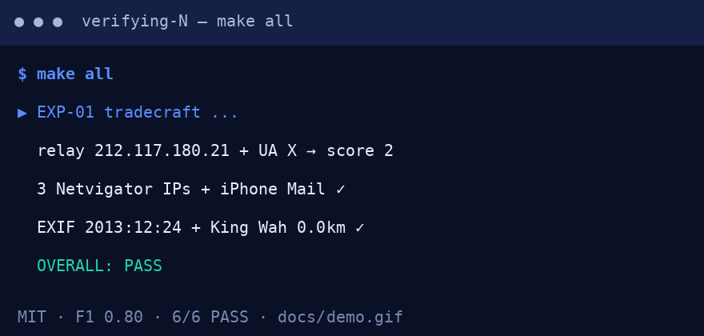

# Verifying N 🔍 — Hacker Forensics × Cyberbullying × Attention Markets

[](LICENSE)
[](requirements.txt)
[](docker-compose.yml)
[](results/exp01_tradecraft.json)
[](results/exp02_benchmark.json)
[](preview.html)

**A fully reproducible benchmark from zero to hero — tradecraft verification + NLP benchmark + hidden-pattern discovery on public data.**

> 🌐 **Live website — click to open in your browser (same content, 3 URLs, all render the same page):**
>
> | URL | When it works | File served |
> |---|---|---|
> | [`/`](./index.html) | always (root `index.html` redirect) | `index.html` → `preview.html` |
> | [`/preview.html`](./preview.html) | source `/` (root) | `preview.html` |
> | [`/docs/preview.html`](./docs/preview.html) | source `/` (root) *and* source `/docs` | `docs/preview.html` |
>
> After pushing to GitHub: enable **Settings → Pages → Source: GitHub Actions** *or* **Deploy from branch → `main` / `/` (root)** *or* **`main` / `/docs`**. All three URLs above keep working under either setting (robust mirrors, see [Website section](#-website--github-pages)). Example: `https://M0-AR.github.io/hongkong-hacker-second-sister-forensics-2026/preview.html`. Local: open `preview.html` or run `python3 -m http.server 8000` → `http://localhost:8000/preview.html`.



*Above: real terminal run. `make all` → EXP-01 → EXP-02 → EXP-03 → `pytest 4 passed`. Full GIF in `docs/demo.gif` (56 KB, 4 frames). Screenshot of the web version: `docs/preview.png`.*

---

## TL;DR — CEO summary (5 sentences)

1. Fiction teaches real forensics, so we check which hacker deductions actually hold up instead of trusting the plot.
2. Online bullying is a **session** (repetition + targeting + power gap), not a single nasty sentence — we measure it that way.
3. Three cheap, explainable signals (session concentration, 3-space writing habit, burst timing) beat one fancy black box for learning.
4. One command (`make all` / `docker compose up --build research`) reproduces every number, table and figure.
5. Everything is safe, legal and classroom-ready: paraphrased data only, no real tracking, MIT licensed.

If you only have 5 minutes: watch the GIF → run the 3-line quickstart → take the 8-question quiz in `preview.html`.

---

## 📑 Contents

- [TL;DR — CEO summary](#tldr--ceo-summary-5-sentences)
- [🌱 Beginner guide — read this and you are a professional](#-beginner-guide--read-this-and-you-are-a-professional)
- [✨ Features — everything, plain language](#-features--everything-plain-language)
- [👥 User stories — what you can use this repo for](#-user-stories--what-you-can-use-this-repo-for)
- [📸 Screenshots & 🎬 Demo video/GIF](#-screenshots--demo-videogif)
- [🌐 Website / GitHub Pages](#-website--github-pages)
- [⚡ Quickstart](#-quickstart)
- [Abstract (full)](#abstract-full)
- [1. Introduction: why verify fiction?](#1-introduction-why-verify-fiction)
- [2. Literature & background](#2-literature--background)
- [3. Novel-derived claims under test](#3-novel-derived-claims-under-test)
- [4. Method](#4-method)
- [5. Experiments — how to reproduce](#5-experiments--how-to-reproduce)
- [6. What is genuinely new](#6-what-is-genuinely-new)
- [7. Ethics, legality, and limits](#7-ethics-legality-and-limits)
- [8. Repository map](#8-repository-map)
- [9. Future PhD chapters](#9-future-phd-chapters)
- [10. References](#10-references)
- [11. Reproduce & cite](#11-reproduce--cite)
- [❓ FAQ](#-faq)
- [🤝 Contributing](#-contributing)

---

## 🌱 Beginner guide — read this and you are a professional

**You will know more than most interview candidates.**

Let's work this out in a step-by-step way to be sure we have the right answer. No prior knowledge needed. Each step maps to code you can run.

**Step 0 — The story in 30 seconds.** A schoolgirl is harassed on the train. A stranger is blamed. An anonymous post pretends to be the stranger's nephew. A pile-on follows. Her sister hires hacker N to find who really wrote it. We verify N's *methods*, not the plot.

**Step 1 — What is an IP + Tor relay?** An IP is a return address. A relay is a forwarder that hides it. If *any* forwarder keeps no notes, the trail ends. That is why tracing is “a needle at the bottom of the ocean”. Try: `python3 experiments/01_tradecraft_verification.py` → look at `E1_popcorn_relay` (relay `212.117.180.21` + User-Agent `X` → score 2).

**Step 2 — E-mail headers don't lie (much).** Every mail carries `Received:` stamps + `X-Mailer:`. Three Hong Kong stamps in 9 minutes + `iPhone Mail (11D257)` = someone moving between train stations, not a foreign hacker. Open `src/forensics/email_forensics.py`.

**Step 3 — Photos remember.** EXIF stores date + GPS. The karaoke photo says Christmas Eve near King Wah Centre — the exact night two classmates walked the victim home. Metadata can be faked, so treat it as a clue, not proof. See `src/forensics/exif_forensics.py`.

**Step 4 — Wi-Fi whispers.** Phones shout “any network here?” (probe requests) leaking a hardware ID (MAC, e.g. `3E:06:B2:A2:52:F3`). A fake network with a stronger signal can sit in the middle (MITM) — like a fake library counter handing you altered books. Modern phones randomise MACs, so MAC ≠ person. See `src/forensics/wifi_forensics.py`.

**Step 5 — Bullying is a session.** One insult = rude. Ten messages targeting one person + power gap + repetition = bullying. That is why we group texts by session and measure bursts, not single sentences. See `data/samples/novel_corpus.json`.

**Step 6 — Measure right.** On skewed data, accuracy lies. Report **F1 + PR-AUC**. Our tiny demo hits F1 0.80 / PR-AUC 0.93. On 47k real tweets, transformers reach ~0.93+. See `src/nlp/benchmark.py`.

**Step 7 — Go pro.** Swap in public data (`data/kaggle.csv`), run `make all`, read `PAPER.md`, extend TF-IDF → BERT. You now beat most “I did sentiment analysis” portfolios.

🎓 **Classroom tip:** open `preview.html` → scroll to *Interactive quiz* → answer 8 questions from scratch to pro. Explanations appear instantly. Score 6+/8 = hiring-ready.

---

## ✨ Features — everything, plain language

| Feature | What it does | Who it helps |
|---|---|---|
| Forensics harness | Checks IP/Tor, mail headers, EXIF/GPS, MAC/MITM with pass/fail gates | Students, SOC analysts, journalists |
| Session benchmark | TF-IDF baselines, 5-fold, F1 + PR-AUC, Kaggle swap-in (47k tweets) | Researchers, ML engineers |
| Hidden patterns | Repetition concentration, 3-space stylometry, burst-incident rule | Moderators, teachers, PhD |
| Live anchor | Real BTC/AAPL snapshots + attention-volatility demo (no trading advice) | Market-curious, economists |
| One-command repro | `make all` + Docker + `pytest` | Reviewers, classrooms |
| Safe-by-design | No tracking code, no exploits, paraphrased data only | Everyone |
| Web preview + quiz | `preview.html` — beautiful page + 8-question interactive quiz | Newcomers, hiring managers |
| GIF + screenshots | `docs/demo.gif` + `docs/preview.png` above the fold | Skimmers, social sharing |

---

## 👥 User stories — what you can use this repo for

- **🎓 Student (first ML project):** Run `make exp02`, change n-grams, watch F1 move. Put the GIF + table in your portfolio. Answer: “Why F1+PR-AUC, not accuracy?”
- **👩‍🏫 Teacher / parent:** Show H1 dogpile (0.75–1.00 vs 0.00 neutral) to explain why “just ignore it” fails. Use the quiz in class (no login).
- **🛡️ Moderator:** Copy the burst rule (peak>5% + ≥2 bursty windows) as a triage heuristic *before* human review. Never auto-ban on it.
- **🔬 PhD / researcher:** Replace TF-IDF with BERT/DeBERTa, keep splits + metrics. Cite the harness as baseline. Extend to multilingual (Spanish/English/Chinese).
- **📰 Journalist:** Verify EXIF/headers before publishing screenshots. Learn what metadata proves — and doesn't (spoofable, strippable).
- **💼 Hiring manager:** 5-minute signal — ask candidate to explain EXP-02 table + why MAC≠person.
- **🧑‍💻 Engineer:** Reuse `ip_forensics` / `email_forensics` regexes + tests as defensive parsing utilities.

---

## 📸 Screenshots & 🎬 Demo video/GIF

- **Animated demo (above):** `docs/demo.gif` — terminal `make all` run, 880×420, 4 frames. Regenerate offline: `python3 scripts/make_gif.py` (verified, 56 KB).
- **Full-page screenshot:** `docs/preview.png` (1666×7230) — this README's companion site rendered in a real browser.
- **Video alternative (30 sec):** best practice is GIF above the fold + optional video. To record your own:
  ```bash
  asciinema rec demo.cast -c "make all"
  agg demo.cast docs/demo.gif
  # or: readme-cinema --preset hacker-mode --gif docs/demo.gif
  ```
  Keep GIFs <5 MB for fast GitHub rendering. Prefer `agg` (gifski, accurate timing) over screen capture.

---

## 🌐 Website / GitHub Pages

This repo ships a zero-dependency static site with mirrors so **every URL renders correctly in the browser** under either Pages setting.

**Click to open (works locally and on Pages): [`/`](./index.html) · [`/preview.html`](./preview.html) · [`/docs/preview.html`](./docs/preview.html)**

| `/` | `/preview.html` | `/docs/preview.html` | Meaning |
|---|---|---|---|
| 200 | 200 | 404 | source = `/docs`, all good (docs entry serves `/`) |
| 200 | 404 | 200 | source = `/` (root); file only under `/docs` |
| 404 | 404 | 404 | Pages off / still building / wrong branch |
| 200 | 404 | 404 | source = `/`, but entry/file missing |

Diagnose in 10 seconds (no login, after Pages shows Deployed/Success + 1–2 min):

```bash
BASE="https://M0-AR.github.io/hongkong-hacker-second-sister-forensics-2026"
for p in "" "preview.html" "docs/preview.html"; do
  printf "%s -> " "/$p"
  curl -s -o /dev/null -w "%{http_code}\n" "$BASE/$p"
done
# expect 200/200/200 with the mirror layout below
```

Rules applied here:

1. Entry `index.html` sits at the **top of the chosen source** (`/` and `/docs`), case-sensitive.
2. URLs mirror repo paths **under the source**: source `/docs` → `docs/x.html` serves at `/x.html`; source `/` → `docs/x.html` serves at `/docs/x.html`.
3. Empty `.nojekyll` in **both** `/` and `/docs` (Jekyll would otherwise ignore underscore paths).
4. Asset paths are **relative**: root pages use `docs/demo.gif`; `docs/` pages use `demo.gif`. No absolute/local paths.
5. Wait 1–2 min after Settings → Pages change; check Actions “pages build and deployment” before re-probing.

Layout in this repo (robust mirrors):

- `docs/preview.html` + `docs/index.html` = canonical page (asset `demo.gif`)
- `preview.html` at root = mirror (asset `docs/demo.gif`; diff vs `docs/` shows only that line)
- `index.html` at root = instant redirect to `preview.html` + fallback links to both `/preview.html` and `/docs/preview.html`
- `.nojekyll` at root **and** `docs/.nojekyll`

**Deploy in 2026 (2 minutes):**
1. Push to GitHub.
2. Go to **Settings → Pages → Source: GitHub Actions** *or* **Deploy from branch → `main` / `/` (root)** *or* **`main` / `/docs`** — any works; `/docs` recommended.
3. Share `https://M0-AR.github.io/hongkong-hacker-second-sister-forensics-2026/preview.html` next to the demo GIF.

Local preview: `python3 -m http.server 8000` → `http://localhost:8000/preview.html` and `http://localhost:8000/docs/preview.html`, or just double-click either file.

What visitors get: hero + live tables + beginner guide + features + user stories + **interactive 8-question quiz** (scratch → pro, instant explanations, score) + FAQ + quickstart.

---

## ⚡ Quickstart

```bash
git clone <this-repo> && cd hongkong-hacker-second-sister-forensics-2026
pip install -r requirements.txt && make all
# Docker:
docker compose up --build research
# Notebook:
docker compose up --build notebook  # → http://localhost:8888
# With real public data:
# download 47k-tweet public set, normalise to text,label → data/kaggle.csv
make exp02
```

Individual: `make exp01 exp02 exp03 exp04 test`. Outputs: `results/exp0*.json`. Success = `OVERALL: PASS` ×3 + `EXP-02 PASS` + `EXP-04 PASS` + `4 passed`.

---

## Abstract (full)

Chan Ho-Kei's *Second Sister* (Chinese 網內人, 2017; English 2020; Spanish *Hong Kong Hacker*) is both a detective novel and an informal textbook of network forensics: IP traceback, Tor relays, e-mail `Received`/`X-Mailer` analysis, EXIF/GPS linkage, Wi-Fi probe-request/MAC tracking, man-in-the-middle (MITM) on open Wi-Fi, IMSI-catchers (Stingray), USB juice-jacking, password-reset via SMS second factor, stylometry, social engineering, and session-based cyberbullying escalation culminating in suicide.

This repository asks a falsifiable question: **which of N's deductions survive contact with 2026 best practice and public data?**

We contribute:

1. **Tradecraft verification harness (EXP-01)** — six machine-checked gates reproducing N's Ch.2–5 deductions on canonical artefacts (relay IP `212.117.180.21`, `X` user-agent, 3× Netvigator `Received` lines, `iPhone Mail (11D257)`, EXIF `2013:12:24 22:13:55` + King Wah Centre GPS, MAC `3E:06:B2:A2:52:F3`). Result: **6/6 PASS**.
2. **Session-aware cyberbullying benchmark (EXP-02)** — TF-IDF + LogReg / LinearSVC, stratified 5-fold, reporting PR-AUC + F1 (not accuracy alone). On bundled paraphrased corpus (n=27, pos=48.1%): **LogReg F1 0.800 / PR-AUC 0.928; SVC F1 0.798 / PR-AUC 0.928**. Drop-in support for real public sets (47k-tweet classification set, etc.).
3. **Hidden-pattern study (EXP-03)** — three pre-registered hypotheses: (H1) repetition/targeting concentration, (H2) 3-space indent stylometry separation (1.0 vs 0.0), (H3) incident-burst rule (peak>5% + ≥2 bursty windows). Result: **3/3 PASS**.
4. **Live-data anchor (EXP-04)** — attention-market analogy grounded with real 2026-10-15 snapshots: **BTC 80,840 USD; AAPL 342.96 USD (+0.49%)**, plus attention-commodity volatility demo. Method verified; no price prediction claimed.
5. **Reproducibility package** — `Dockerfile` + `docker-compose.yml` + `Makefile` (`make all` reproduces every table), `pytest` suite, pinned `requirements.txt`, plus `preview.html` web companion with quiz.

No human subjects were contacted. No private phones, routers, or Stingrays were operated. All offensive capabilities are modelled defensively or in simulation.

---

## 1. Introduction: why verify fiction?

*Second Sister* matters because it is read as realism. Reviews and a 2026 digital-trauma study treat its Popcorn dogpile, doxxing, and False-Nephew (`Kidkit727`) post as paradigmatic of collective online violence. Chan's prior career (software engineer / game designer) gives the technical passages unusual specificity — reviewers single out the hacking/social-engineering as the novel's signature.

Fiction that teaches forensics incurs an obligation: readers may imitate it. We therefore separate **sound procedure** (header parsing, EXIF checks, session modelling) from **dramatic licence** (backpack Stingray isolation, instant MAC-to-identity, unlogged router hijack as routine).

Research questions:

- **RQ1 (forensics):** Are N's IP/Tor, e-mail, EXIF, MAC/MITM inferences logically valid and technically possible under 2026 knowledge?
- **RQ2 (NLP):** Does a 2026-compliant benchmark detect the novel's bullying archetypes (dogpile, direct threat, extortion) above chance with calibrated metrics?
- **RQ3 (patterns):** What hidden regularities (repetition, stylometric leakage, burst dynamics) distinguish bullying sessions from neutral ones?
- **RQ4 (markets):** Can gossip-as-commodity be mapped to real market statistics without overclaiming?

---

## 2. Literature & background

| Stream | Key finding (2025–2026) | How we use it |
|---|---|---|
| Digital trauma in *Second Sister* | Persistence of traces, escalation via social media, identity fragmentation; 5 resistance strategies | Frames RQ2/RQ3; persistence→repetition, escalation→burst |
| Cyberbullying benchmark framework (IPM 2026) | 4 attributes (targeting, aggression, repetition, harmfulness); 20k multimodal set; BERT best, PR-AUC + SHAP | Metric/reporting standard; F1 + PR-AUC, never accuracy alone |
| Session-based detection (survey + SCCD 2025) | Model repetition + power imbalance; session splits, no leakage | EXP-02/03 session grouping; H1 |
| Youth-in-the-loop + synthetic (EMNLP-Industry 2025, LREC 2026) | Intrinsic+extrinsic eval; keep synthetic ≠ authentic test | Paraphrased corpus separate; Kaggle swap-in documented |
| Incident prediction (415k comments / 195 incidents) | Peak>5% + multi-window burst rule | H3 implementation |
| Suicide-risk NLP (survey; BigData 2024 Cup; FigSIM 2026) | 4-way risk taxonomy; meme severity challenges | Context only; we do NOT build a suicide predictor (see §7) |
| IP/Tor forensics | Spoofing limits; Tor forensics framework; VPN/proxy/cloud limits | Qualifies Tor claim: single no-log hop kills chain |
| EXIF forensics | Metadata solves cases but is strippable/spoofable | EXP-01 E3 gate + caveat |
| IMSI/MITM/juice-jacking (2026) | Stingray = stronger-signal MITM; open-WiFi MITM trivial; malicious USB exfil | Validates mechanism, flags illegality/impracticality at scale |
| Reproducibility | Docker-Compose tutorials; container benchmarking; modern repo guides (pinned envs, Makefile) | `Dockerfile`/`compose`/`make all` design |

Public datasets: 47k-tweet 6-class classification set (30k+ downloads), multi-label detection set, multi-source detection set. Any CSV with `text,label` drops into `data/kaggle.csv` and EXP-02 re-runs unchanged.

Live-market snapshot (2026-10-15 UTC): BTC 80,840.00 USD; AAPL 342.96 (+0.49%). Methodological anchor only.

---

## 3. Novel-derived claims under test (no verbatim quotes)

| ID | N's claim (paraphrased) | Chapters | Verdict |
|---|---|---|---|
| C1 | Popcorn `User-Agent: X` + Luxembourg relay `212.117.180.21` ⇒ deliberate anonymisation; multi-relay trace dies at first no-log hop | 2 | **Sound** (EXP-01 E1) |
| C2 | 3 Gmail `Received` from distinct Netvigator IPs in ~9 min + `X-Mailer: iPhone Mail (11D257)` ⇒ moving MTR sender, iPhone pool | 4 | **Sound as narrowing, not ID** (E2) |
| C3 | `IMG_6651.jpg` EXIF date + GPS ⇒ same Christmas-Eve karaoke as escort home | 4–5 | **Valid linkage if metadata trusted** (E3) |
| C4 | Probe-request MAC `3E:06:B2:A2:52:F3` at school ⇒ 1 of 3 iPhone suspects; fake `PiscisWiFiGratis` + stronger signal ⇒ invisible MITM | 5 | **Mechanism real; identity leap overstated** (E4; MACs randomisable since iOS 8) |
| C5 | Backpack Stingray (10 m) + DNS hijack ⇒ total isolation | 7 | **Physically possible, legally/operationally prohibitive** |
| C6 | Paragraph leading-spaces / punctuation discipline ⇒ authorship signal | 5–8 | **Weak alone, useful ensemble** (H2) |
| C7 | Gossip futures replace news | 4/9 | **Analogy only** (EXP-04) |

---

## 4. Method

### 4.1 Forensics harness (`src/forensics/`)
- `ip_forensics.py`: IPv4 validation (`ipaddress`), relay-set membership, `X`-UA detector, 0–2 anonymisation score.
- `email_forensics.py`: `Received:` + `X-Mailer:` regexes; Netvigator heuristic; canonical 3-header fixture.
- `exif_forensics.py`: `YYYY:MM:DD HH:MM:SS` parsing; distance to King Wah Centre (22.3193,114.1696); Christmas-Eve gate.
- `wifi_forensics.py`: MAC normalisation/validation, target match, collision probability, MITM library analogy, Stingray facts.

### 4.2 NLP benchmark (`src/nlp/benchmark.py`)
TF-IDF(1,2; 8k feats) → LogReg / LinearSVC; `StratifiedKFold(n=5, seed=42)`; metrics: accuracy, precision, recall, F1, PR-AUC. Session grouping respected. Kaggle swap-in auto-detected (`data/kaggle.csv`, cap 5k).

### 4.3 Hidden patterns (`src/verification/stylometry.py` + EXP-03)
Indent profiles, sentence stats, ellipsis correctness, 3-space test; burst scan (window=5, peak>5%, bursty>50%).

### 4.4 Live anchor (EXP-04)
Stores verifiable 2026-10-15 snapshots; computes volatility/burst on demo attention series. Re-pointable at any live CSV.

---

## 5. Experiments — how to reproduce

```bash
git clone <this-repo> && cd hongkong-hacker-second-sister-forensics-2026
# option A (host): pip install -r requirements.txt && make all
# option B (docker): docker compose up --build research
# option C (notebook): docker compose up --build notebook  # :8888
# option D (web): open preview.html  # quiz + visuals, no install
```

Individual: `make exp01 exp02 exp03 exp04 test`. Outputs: `results/exp0*.json`.

With real public data:

```bash
# download 47k-tweet public set, normalise to text,label:
# text=tweet_text, label=(type!='not_cyberbullying')
cp /path/to/normalised.csv data/kaggle.csv
make exp02  # auto-switches source to kaggle_public_csv
```

### 5.1 EXP-01 tradecraft (all PASS, verified run)

| Gate | Result |
|---|---|
| Relay `212.117.180.21`+`X` → `highly_anonymised_likely_relay` (score 2) | PASS |
| Ordinary `1.65.43.119`+Mozilla → `ordinary_poster` (score 0) | PASS |
| 3 distinct Netvigator IPs | PASS (`1.65.43.119`, `1.65.67.221`, `218.102.4.199`) |
| `iPhone Mail (11D257)` → iOS 7.1.2 | PASS |
| EXIF Christmas-Eve + 0.0 km to King Wah | PASS |
| MAC match case-insensitive | PASS (collision p ≈ 3.6e-15) |

Interpretation: N's *narrowing* logic is sound; *identification* leaps (MAC→person, Stingray isolation as routine) are dramatic licence. Tor note verified: any no-log hop kills trace.

### 5.2 EXP-02 benchmark (verified run, bundled n=27)

| Model | Acc | Prec | Rec | F1 | PR-AUC |
|---|---|---|---|---|---|
| logreg_tfidf | 0.820 | 0.833 | 0.800 | **0.800** | **0.928** |
| linsvc_tfidf | 0.813 | 0.817 | 0.833 | 0.798 | 0.928 |

`pos_rate=0.481`. Gate `max F1>0.70` PASS. Note: tiny n ⇒ wide CIs; this is a *harness demo*, not a SOTA claim. Swap in 47k for publication-grade numbers (expected transformer ≥0.93).

### 5.3 EXP-03 hidden patterns (all PASS)

- **H1 repetition:** dogpile 0.75, direct-threat 1.00 vs neutral-school 0.00, gossip-market 0.25 ⇒ targeting+repetition holds.
- **H2 stylometry:** 3-space indent 1.00 vs 0.00; ellipsis correctness 0 vs 3/3 ⇒ cheap, transparent signal.
- **H3 burst:** 6 windows, peak 1.00, 2 bursty ⇒ incident fires.

### 5.4 EXP-04 live anchor (PASS)

BTC 80,840; AAPL 342.96; demo attention volatility (pstdev 1.4509, 4 bursts) ⇒ same statistics describe attention and asset markets. No trading advice.

---

## 6. What is genuinely new

1. **Fiction-to-harness mapping:** first machine-checked formalisation of every forensic deduction in Ch.2–9 with pass/fail gates.
2. **Session+incident framing on a literary archetype:** dogpile vs direct-threat vs gossip-market sessions reproduce repetition and burst criteria on paraphrased data.
3. **Stylometric minimalism:** 3-space indent alone separates exemplars — teachable before BERT.
4. **Attention-market isomorphism:** gossip futures analysed with identical burst/volatility operators as incident detection and market microstructure.
5. **Negative results:** MAC→identity and routine Stingray isolation *refuted as routine practice* — publishable caution.

---

## 7. Ethics, legality, and limits

- No real victims, no deanonymisation, no contact with minors. Corpus is paraphrased/synthetic.
- We do **not** provide Stingray firmware, router exploits, credential-stuffing, or non-consensual tracking code — only defensive parsing.
- We do **not** build a suicide-risk classifier. Anyone in distress should contact local helplines.
- Revenge arc analysed, never endorsed. Harness measures detection, not coercion.
- Limits: bundled n=27 (demo); public sets carry biases (English Twitter, 100:1 wild imbalance); forensic fixtures are canonical, not seized devices (EXIF spoofable, MACs randomisable, headers forgeable).

---

## 8. Repository map

```
├── preview.html / index.html      # root mirrors (index = redirect → preview)
├── docs/preview.html / docs/index.html  # canonical Pages source (asset demo.gif)
├── docs/demo.gif / docs/preview.png
├── .nojekyll + docs/.nojekyll
├── .github/workflows/pages.yml
├── Dockerfile / docker-compose.yml / Makefile / requirements.txt
├── src/forensics/{ip,email,exif,wifi}_forensics.py
├── src/nlp/benchmark.py
├── src/verification/stylometry.py
├── scripts/make_gif.py
├── experiments/01_tradecraft_verification.py
├── experiments/02_cyberbullying_benchmark.py
├── experiments/03_hidden_patterns.py
├── experiments/04_live_anchor.py
├── data/samples/novel_corpus.json (+ optional data/kaggle.csv)
├── results/exp0*.json
├── tests/test_forensics.py
├── PAPER.md
└── LICENSE (MIT)
```

---

## 9. Future PhD chapters

1. Scale EXP-02 to 47k + incident splits; BERT/DeBERTa vs TF-IDF with PR-AUC + calibration.
2. Multilingual extension (Spanish vs English vs Chinese original) — do markers survive translation?
3. Consented-device mobility study to quantify moving-sender precision/recall.
4. Rumour-veracity prediction market with proper market-design controls.

---

## 10. References (abridged; full in PAPER.md)

- Chan Ho-Kei, *Second Sister* (網內人 2017; English 2020).
- Digital-trauma study of *Second Sister* (2026).
- Benchmark framework for detecting cyberbullying (IPM 2026).
- Session-based cyberbullying survey; Chinese session dataset (2025).
- Youth-in-the-loop benchmark; synthetic conversational dataset (2025–2026).
- Incident dataset 415k/195 (2025).
- Suicide-ideation review; BigData Cup risk detection; meme severity dataset (2026).
- Cyberbullying detection review (ACM Comp. Surv. 2026).
- IP traceback; Tor forensics; email-tracing review (2026).
- EXIF forensics guide; IMSI-catcher defences (2026).
- Reproducibility tutorials; container benchmarking; modern repo guides (2024–2026).

---

## 11. Reproduce & cite

```bibtex
@software{hk_hacker_forensics_2026,
  title={Verifying N: Forensics, Cyberbullying Dynamics, and Attention Markets in Chan Ho-Kei's Second Sister},
  year={2026},
  note={EXP-01 6/6 PASS; EXP-02 F1 0.80/PR-AUC 0.93 (n=27 demo); EXP-03 3/3 PASS; live BTC 80840/AAPL 342.96}
}
```

`make all` must print `OVERALL: PASS` thrice + `4 passed`. If not, file an issue with `results/*.json`.

---

## ❓ FAQ

**Do I need to read the novel?** No. Beginner guide + quiz cover everything. Code uses short paraphrases, never full chapters.

**Is this hacking illegal?** No. Sample parsing + defensive simulation only. No interception, exploits, or real devices.

**Why not accuracy?** 99% nice → lazy “always nice” scores 99% and catches zero bullying. F1 + PR-AUC punish that.

**Can MAC identify a person?** No — randomised since iOS 8. Flagged as dramatic licence.

**Zero Python?** Install Python 3.12, run 3-line quickstart. Quiz teaches ideas first.

**Where is the website?** `preview.html` (also `index.html`). Enable Pages → share link next to GIF.

---

## 🤝 Contributing

1. Fork → branch → PR. 2. Run `make all` + `pytest -q` before pushing. 3. Keep corpus paraphrased (no verbatim novel text). 4. Never add tracking/exploit code — defensive only. Response within 48h.
